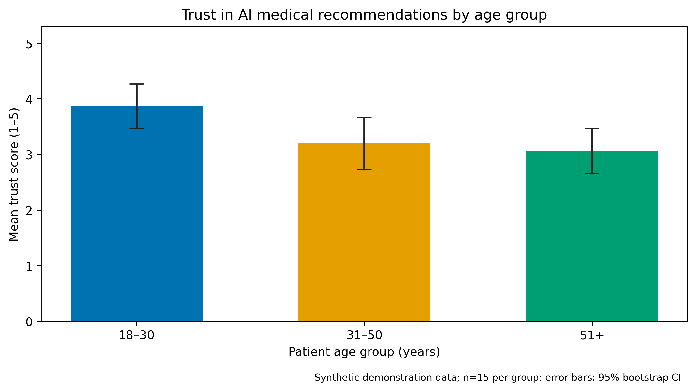

# Trust in AI-Generated Medical Recommendations Among Patients

**Authors:** Sharipkhan Merey and Olzhabek Marzhan  
**Research Study — Research Results, Data Analysis, and Scientific Visualization**  
**GitHub:** https://github.com/marzhanolzhabek/ai-medical-trust-research

## Research question and provenance
We investigate self-reported trust ratings (1–5) in AI-generated medical recommendations in **three adult patient age categories: 18–30, 31–50, and 51+**. The research demonstration dataset contains **45 synthetic records: 15 per cohort**. No actual patients participated. Thus, sample trust contrasts are illustrative and are **not empirical findings** or hypothesis tests. The original Research Study materials may reflect an earlier research design; verify topic continuity with the lecturer before submission.

## Survey research results (synthetic demonstration only)

| Age group | n | Mean (1–5) | Median | SD | 95% bootstrap CI for mean |
|---|---:|---:|---:|---:|---|
| 18-30 | 15 | 3.87 | 4.0 | 0.83 | 3.47–4.27 |
| 31-50 | 15 | 3.20 | 3.0 | 1.01 | 2.73–3.67 |
| 51+ | 15 | 3.07 | 3.0 | 0.80 | 2.67–3.47 |

The trust scale is a self-reported opinion, not a medical outcome or clinical-accuracy measure.




## Results & Discussion — baseline vs proposed software processing

**Two real implementations were measured during this archive's preparation:** baseline = three full scans over the same records (one for each cohort); proposed = one-pass validation and aggregation. Both compute **the same group counts and mean trust ratings**, verified across four input sizes in automated tests. This is **software processing latency**, not AI-generated medical recommendation latency. Timing covers in-memory validation and aggregation, excluding file I/O and survey bootstrap calculations.

The workloads of **45, 90, 180, and 360 records** were constructed by repeating the same 45 synthetic records with distinct technical IDs. They are **not extra patients, independent samples, or additional collected data**. Warm-ups are explicitly logged and omitted: **10 warm-ups and 80 measured executions per method and load** (720 total JSONL entries; 640 benchmark entries). Measurements were collected in the assistant's execution environment, **not on the students' MacBook**, and machine-specific timings should be rerun locally for own-system performance claims.

| Records/load | Baseline median (p25–p75) ms | Proposed median (p25–p75) ms | Baseline p95 / p99 ms | Proposed p95 / p99 ms | Error rate |
|---:|---|---|---|---|---|
| 45 | 0.0744 (0.0738–0.0753) | 0.0409 (0.0407–0.0413) | 0.1371 / 0.2075 | 0.0542 / 0.0737 | 0% / 0% |
| 90 | 0.1273 (0.1263–0.1315) | 0.0695 (0.0689–0.0702) | 0.1889 / 0.2612 | 0.0990 / 2.3808 | 0% / 0% |
| 180 | 0.2390 (0.2270–0.3298) | 0.1259 (0.1248–0.1333) | 0.4921 / 1.0940 | 0.2065 / 0.3574 | 0% / 0% |
| 360 | 0.4471 (0.4353–0.4716) | 0.2428 (0.2397–0.2618) | 0.5955 / 0.7881 | 0.3186 / 0.4013 | 0% / 0% |

On this controlled repeated-input benchmark, the proposed one-pass implementation has lower median processing time at all four loads. Bootstrap 95% confidence intervals around measured **median latency** quantify run-to-run uncertainty, not uncertainty about real patients. The small runtimes are sensitive to machine activity; avoid treating the benchmark as a universal performance claim.


## Benchmark methodology

1. Ingest `data/raw/test_run.jsonl`; validate schema; exclude `phase=warmup`.
2. Compute measured median latency, p25/p75, p95/p99, error rate per method/load. Bootstrap **95% CI for the median** with a fixed seed of 42 and 2,000 resamples. Failed evaluation runs contribute to the error-rate denominator and are excluded from successful-runtime percentiles.
3. Render figures with clearly labeled axes and units, CI bars, colorblind-safe series plus markers/line styles; export 350 DPI PNG and vector PDF.
4. Keep the original synthetic trust analysis as an additional, clearly separated outcome demonstration.

## Reproducibility

From the repository root (Python 3.10+):

```bash
python -m pip install -r requirements.txt
python src/process_data.py
python src/visualize.py
python src/compare_methods.py            # overwrites test_run.jsonl with new local measurements
python src/benchmark_statistics.py
python src/benchmark_visualize.py
python -m unittest discover -s src -p 'test_*.py'
jupyter notebook notebooks/01_data_analysis.ipynb
```

The `notebooks/01_data_analysis.ipynb` stores outputs from a clean Run All. **Do not rerun the collector during the notebook execution**: it reads the existing recorded JSONL for reproducible reporting.

## Domain model, deliverables and research ethics

- [C4 domain model highlighting two distinct measurement points](docs/domain_model.md)
- [Methodology Passport](docs/methodology_passport.md)
- [Executed Jupyter notebook](notebooks/01_data_analysis.ipynb)
- [PDF research report](reports/Patient_Age_Trust_Report.pdf)
- [Processed benchmark table](data/processed/metrics_summary.csv)
- [Previous single-load measurement log (provenance)](data/raw/test_run_previous_single_load.jsonl)

No identifiable personal records are included. If expanding to real participants, obtain consent, appropriate review, and secure data handling. This repository does **not** evaluate medical accuracy, safety, or real-world patient trust.
