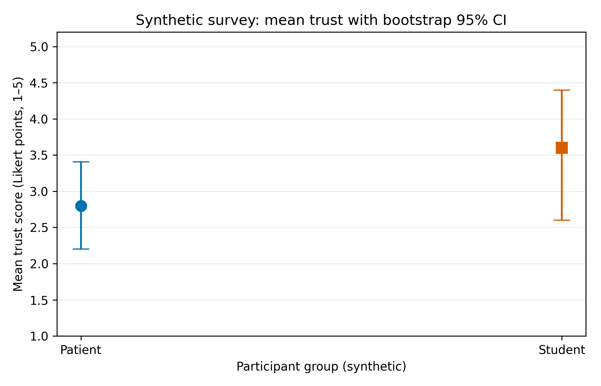
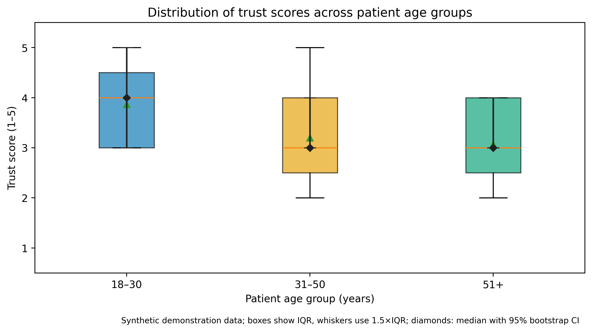

# Trust of Students and Patients in Medical Recommendations Generated by Artificial Intelligence — TASK 3

**Authors:** Sharipkhan Merey; Olzhabek Marzhan

## Results & Discussion

The available dataset contains 10 **synthetic demonstration responses** (5 students and 5 patients), not real participant data. No Week 7–8 performance logs were provided; warm-up filtering and latency-versus-load results cannot be reported.

| Group | n | Mean ± SD (trust score, 1–5) | Median (p25–p75) | p95 | p99 | Bootstrap 95% CI |
|---|---:|---:|---|---:|---:|---|
| Patient | 5 | 2.80 ± 0.84 | 3.00 (2.00–3.00) | 3.80 | 3.96 | [2.20, 3.41] |
| Student | 5 | 3.60 ± 1.14 | 4.00 (3.00–4.00) | 4.80 | 4.96 | [2.60, 4.40] |

**Mean trust difference (student − patient):** 0.80 points (synthetic data only).

**Guardrail metric:** Invalid response rate: 0/10 (0%).

Both figures are also available as PDF files in `reports/figures/`.

## Domain Model

[C4-style domain diagram](docs/domain_model.md)

## Reproducibility

Install dependencies using `pip install -r requirements.txt`. Run `notebooks/01_data_analysis.ipynb` from start to finish. Processing and plotting modules are in `src/process_data.py` and `src/visualize.py`. Random seed: 42.
