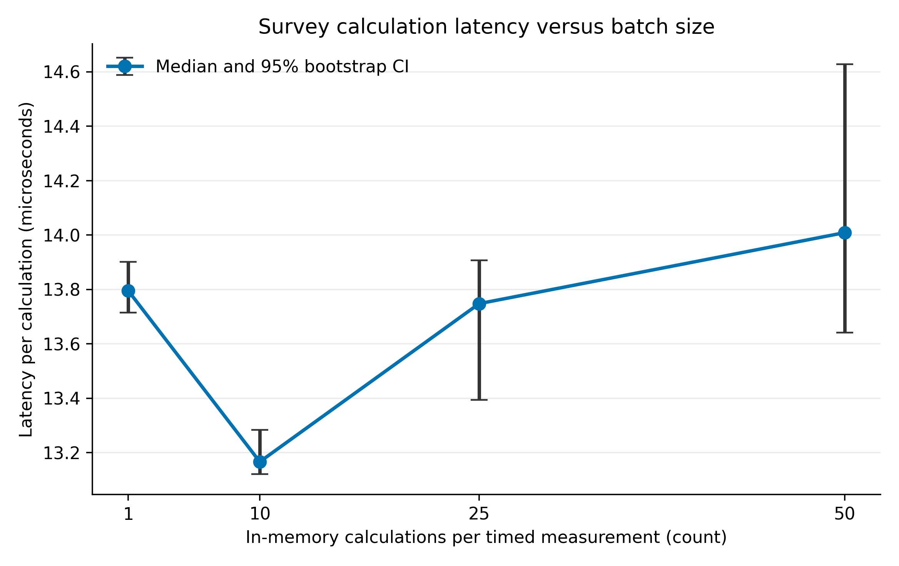
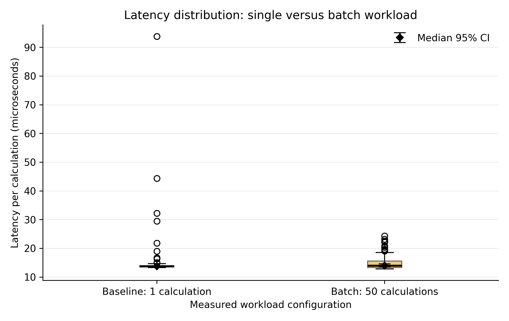

# Trust in AI-Generated Medical Recommendations: Survey Benchmark

**Authors:** Sharipkhan Merey; Olzhabek Marzhan  
**Course:** Research Methods — Tasks 2 and 3  
**Research theme (from Task 1):** Trust of Students and Patients in Medical Recommendations Generated by Artificial Intelligence.

## Overview
This repository implements a **reproducible survey-data quality and descriptive benchmark**, not a medical recommendation model. It compares the mean self-reported trust score (1–5 Likert scale) for student and patient respondents. The Week 6 data file contains **10 synthetic demonstration responses only**: these are not actual participants and may not be presented as empirical findings. Real anonymized responses are intended for a later data collection stage.

## Research Questions
- **RQ1:** What is the level of trust in AI medical recommendations among students and patients? Is there a difference?
- **RQ2:** How are AI knowledge, perceived accuracy, explanation clarity, and doctor supervision associated with trust?
- **RQ3:** Is prior AI use associated with higher trust?

**Primary comparison:** student mean trust score minus patient mean trust score. The baseline is the patient group measured using the identical 1–5 scale. The pipeline currently computes descriptive metrics only; statistical inference and covariate adjustment will be added when enough real data exists.

## System Requirements
- Python 3.12 (standard library only; no third-party packages required)
- Optional: Docker with local Docker daemon

## Quickstart (2 commands; from repository root)
```bash
python3 src/benchmark.py --config configs/config.json
python3 -m unittest discover -s src -p 'test_*.py'
```
Result is written to `results/benchmark_results.json` and printed to the console.

### Docker (optional; 2 commands)
```bash
docker build -t ai-medical-trust-task2 .
docker run --rm ai-medical-trust-task2
```

## Repository Layout
```text
.
├── README.md
├── LICENSE
├── .gitignore
├── .dockerignore
├── Dockerfile
├── configs/config.json
├── data/sample/sample_synthetic.csv
├── docs/methodology_passport.md
├── notebooks/.gitkeep
├── results/.gitkeep
└── src/
    ├── benchmark.py
    └── test_benchmark.py
```

## Planned Benchmarks
| Measure | Operational definition | Baseline / threshold |
|---|---|---|
| **Primary: mean trust difference** | Mean(1–5 trust, students) - Mean(1–5 trust, patients) | Patient mean; difference of 0 = no observed group gap |
| Trust by AI experience | Mean trust among prior AI users and non-users | Non-users |
| Factor associations | Association of knowledge, accuracy, clarity, supervision with trust, in later analysis | Null association |
| **Guardrail: valid completion rate** | Valid rows / all rows | >= 90% |
| **Guardrail: invalid response rate** | Invalid or duplicate rows / all rows | <= 10% |
| Minimum sample size for planned inference | Number of valid respondents per group | >= 30 per group (planning threshold, not power analysis) |

## Data, Ethics, and Reproducibility
Do not upload names, phone numbers, diagnoses, or any other identifying or sensitive health information. Seek informed consent and apply your institution's research ethics rules before collecting real responses. Synthetic values are labeled and must not be interpreted as evidence for H1. Survey questions should clearly specify the medical-advice scenario and consistently apply the 1–5 response scale. Version and document any instrument changes. This repository uses Python standard library, eliminating external runtime dependencies; `Dockerfile` pins the Python image tag.

## Citation / License
Research basis: Sharipkhan, M., & Olzhabek, M. (2026). *Trust of Students and Patients in Medical Recommendations Generated by Artificial Intelligence* (Task 1 research proposal, unpublished coursework).  
Source reference list: see Task 1 Zotero library / BibTeX export.  
Software: MIT License (see `LICENSE`).

## Week 7 Studio — Measurement Collection (synthetic test data only)

This extends Task 2 without replacing the original survey benchmark. A separate `src/collector.py` runs **10 discarded warm-up passes** and **120 measured passes** (50 in-memory calculations per pass). It isolates file I/O and console printing from the timed section, logs every pass (including failures) as one JSON Lines (`.jsonl`) record with a UTC microsecond timestamp, and reports mean, median, p95 and p99 execution time in **microseconds**. CPU, OS, RAM and Python metadata are also reported when supported.

### Quickstart (from repository root, Python 3.12+)

```bash
python3 src/collector.py --config configs/config.yaml
python3 -m unittest discover -s src -p 'test_*.py'
```

Results: `data/raw/test_run.jsonl` (120 lines) and `results/week7_summary.json`.

### Configuration and interpretation

`configs/config.yaml` is written in **JSON syntax, which is valid YAML 1.2**; this lets the Python standard library read it without external packages. Warm-up runs and workload parameters are in `workload`. `timeout_seconds` and `random_seed` are reserved configuration entries for future I/O- or randomness-based workloads; they do **not** currently control timed work. Repeated runs process the *same small synthetic survey*, not synthetic web requests. Pareto/normal network traffic, API retries, and cold-start/JIT effects are **not applicable** to this offline pure-Python processing function. Additional edge-case unit tests cover empty or invalid survey records. The log is **technical performance evidence**, not a human-subject study nor validation of H1 hypotheses.

Measured timings can still fluctuate due to operating-system load; p95/p99 describe this specific computer/run, not an universal performance guarantee. For stronger comparisons, run under equivalent resource limits and more datasets.


---

# Task 3 — Research Results, Analysis & Scientific Visualization

## Objective and data provenance

This submission expands the Task 2 benchmark with reproducible Week 7–9 **technical runtime** observations. `data/raw/test_run.jsonl` preserves the Week 7 smoke-test set (120 runs), and `data/raw/load_{1,10,25,50}.jsonl` holds **480 additional locally collected observations (120 at each load)** from one software environment. Each load had 10 additional untimed warm-up invocations **discarded before logging**. Data are technical measurements from a synthetic 10-row survey; they are **not** real patient data or experimental evidence for the RQ hypotheses. Neither workload is a new AI model.

## System Requirements and Task 3 Quickstart

- Python 3.12+; package versions exactly pinned in `requirements.txt`.
- Install dependencies: `python3 -m pip install -r requirements.txt`
- Regenerate summary and figures: `python3 src/process_data.py --root .` then `python3 src/visualize.py .`
- Notebook: `jupyter notebook notebooks/01_data_analysis.ipynb` (already executed with all cell outputs saved).
- Verification: `python3 -m unittest discover -s src -p 'test_*.py'`
- Optional fresh batch: `python3 src/collector.py --config configs/task3_load_50.yaml` (replaces existing measurements; actual timing differs by machine).

## Results & Discussion — Technical Workload Benchmark

The baseline is **load 1** (one in-memory survey calculation). The proposed *batch workload* is **load 50** (50 repeated calculations within each timed measurement), **not** a proposed clinical/ML model. Results below are from one local environment; all confidence bounds are nonparametric bootstrap 95% intervals for median time per calculation, 2,000 resamples and seed 42. Total durations are reported separately to avoid implying that 50 calculations have the same latency as one.

| Workload (calculations / timed measurement) | Runs | Median total latency (µs) | p95 (µs) | p99 (µs) | Median per calculation (µs), 95% CI | Error rate |
|---|---:|---:|---:|---:|---:|---:|
| **Baseline** — 1 | 120 | 13.80 | 16.84 | 42.06 | 13.80 [13.72, 13.90] | 0.0% |
| 10 | 120 | 131.66 | 279.38 | 690.18 | 13.17 [13.12, 13.28] | 0.0% |
| 25 | 120 | 343.69 | 461.89 | 610.56 | 13.75 [13.39, 13.91] | 0.0% |
| **Proposed batch** — 50 | 120 | 700.43 | 987.11 | 1153.43 | 14.01 [13.64, 14.63] | 0.0% |

**Interpretation.** Batching changes per-calculation overhead, while total measurement latency naturally rises with workload size. Measured differences are not necessarily statistically independent; intervals capture limited run-to-run noise. The error-rate guardrail was 0% in this sample, not a guarantee. The synthetic student/patient mean difference of 0.8 from Task 2 is strictly a pipeline smoke-test demonstration, **not** human research data. No H0/H1 is claimed to be confirmed or rejected.

## Scientific Figures





Both are additionally available as vector PDF and raster PNG (320 dpi) in `reports/figures/`.

## Domain Model

See the [C4-style component model and explicit measurement collection points](docs/domain_model.md). It defines where latencies and errors are recorded and how cleaned metrics reach the figures.

## Task 3 Reproducibility and file layout

```text
data/raw/test_run.jsonl             # Week 7 sample (120 measurements)
data/raw/load_{1,10,25,50}.jsonl   # Additional Task 3 workloads (120 each)
data/processed/metrics_summary.csv # Aggregated statistics
docs/domain_model.md               # C4-style Mermaid component diagram
notebooks/01_data_analysis.ipynb   # Executed notebook with visible cell outputs
reports/figures/                   # Two publication-ready plots (.pdf and .png)
src/process_data.py                # Statistics module
src/visualize.py                   # Figure generation module
reports/Task3_Research_Report.pdf  # Self-contained PDF submission
```

Only small technical JSONL logs (not sensitive clinical data) are committed. The `.gitignore` excludes large unapproved raw dumps, checkpoints, compiled caches, and virtual environments.

## Ethics and limitations

Actual participants were not recruited; these synthetic data and technical logs cannot support medical conclusions. Runtime is machine- and load-sensitive. Error failures have not been stress-tested on all possible malformed inputs; numerical confidence intervals are conditional on the observed hardware and repeated-run assumptions.
