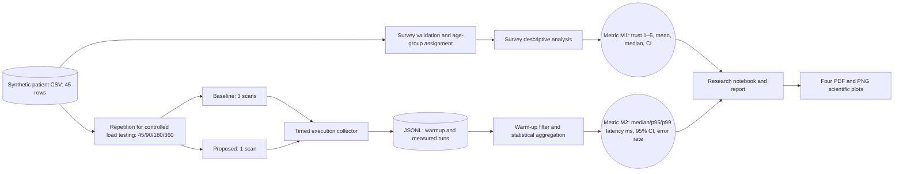

# C4 Component Diagram — Synthetic Patient-Age Survey Processing

**System boundary:** offline Python data processing on a synthetic demonstration file. M1 is the *research opinion score*, while M2 is *software processing speed and reliability*. Only M2 uses simulated workload scaling, with repeated input rows; no additional human participant data and no AI model inference are included. The diagram is a C4-inspired component-level depiction with explicit collection nodes.
