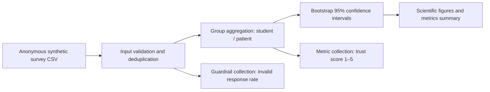

# Domain model — survey pipeline (Software Engineering / C4-style)

**Measurement points:** B measures invalid and duplicate rows; C measures group mean, median, p95 and p99; D measures bootstrap 95% CI. The Task 2 dataset is a synthetic pipeline test, not a clinical or population study.
